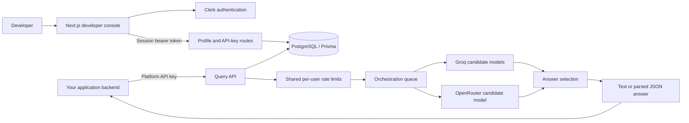
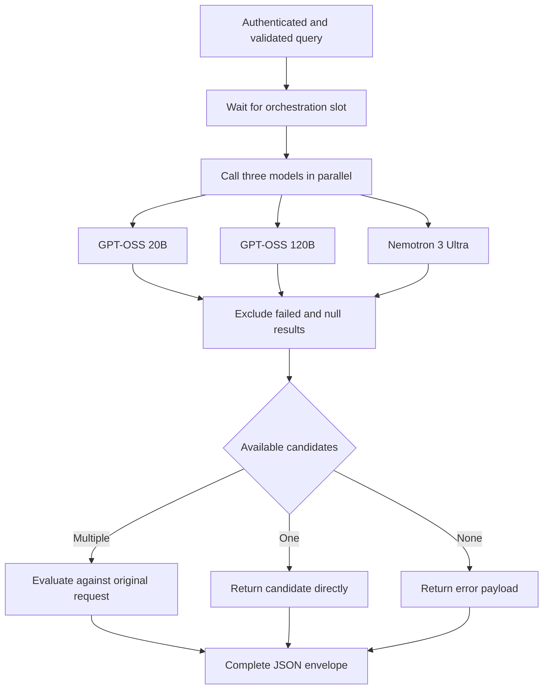

<div align="center">

# Inference

### Multiple models. One API. A considered answer.

A TypeScript AI inference platform that runs candidate models in parallel, evaluates available answers, and gives your application one selected response.


[Quick start](#quick-start) | [Architecture](#architecture) | [API example](#make-your-first-request) | [Backend guide](backend/README.md) | [Frontend guide](frontend/README.md)

</div>

## Overview

Inference brings multi-model generation, answer selection, and developer access management into one project. Instead of wiring separate provider calls and comparison logic into each application, you send a question with optional code, language, and reference context to a single HTTP endpoint. The backend coordinates three candidate models and returns one answer in text or parsed JSON form.

Generation and evaluation have separate roles. **GPT-OSS 20B**, **GPT-OSS 120B**, and **Nemotron 3 Ultra** receive the same context in parallel. When multiple candidates are available, a dedicated evaluation step compares them against the original request for correctness, relevance, completeness, and requested format. If only one candidate is available, the backend returns it directly. This is a selection workflow; it does not merge all model responses into a new answer.

The repository includes a responsive website and developer console for onboarding, Clerk authentication, account synchronization, API-key management, and copyable Python/TypeScript integration examples. Your application calls the inference API from its own backend, keeping platform keys and provider credentials out of browser code.

## Highlights

| Capability | What you get |
| --- | --- |
| Parallel generation | Three candidate model calls coordinated through one query endpoint |
| Answer evaluation | A separate selection step when multiple candidates are available |
| Text and JSON modes | Answer text by default, or parsed JSON with `responseType: "json"` |
| Developer console | Account profile, API-key lifecycle, architecture reference, and integration docs |
| Credential management | Server-generated API keys, SHA-256 hash storage, and revocation |
| Shared request limits | Per-user minute and daily limits across authenticated routes and keys |
| Typed integration examples | Python and TypeScript examples with response and failure handling |
| Responsive interface | Desktop/mobile navigation, searchable console sections, and clipboard actions |

## Architecture

The website manages developer access. Integrating applications send inference requests directly to the Express backend using platform API keys.



### Query lifecycle



The queue permits one active orchestration request per backend process. The provider calls within that request run in parallel. Public responses are delivered as complete JSON, rather than streamed tokens.

### Model ensemble

| Role | Model | Provider |
| --- | --- | --- |
| Candidate | `openai/gpt-oss-20b` | Groq |
| Candidate | `openai/gpt-oss-120b` | Groq |
| Candidate | `nvidia/nemotron-3-ultra-550b-a55b:free` | OpenRouter |
| Evaluation | `openai/gpt-oss-120b` | Groq |

These identifiers reflect the current source configuration. Evaluation is model-based selection, not a guarantee of correctness or a substitute for application-specific validation.

## Quick start

### Prerequisites

- Bun installed locally.
- A reachable PostgreSQL database.
- One Clerk application shared by the frontend and backend.
- Groq and OpenRouter API credentials for query execution.

Install dependencies separately in each application; the repository has no root package script. The commands below use PowerShell.

### 1. Clone the repository

```powershell
git clone https://github.com/subhamoydatta703/AI-Inference-Platform.git
cd AI-Inference-Platform
```

### 2. Start the backend

```powershell
cd backend
bun install
```

Create `backend/.env` with the variables in the [backend setup guide](backend/README.md#local-setup). Configure your Clerk session token to include the signed-in user's email in its `email` claim. Then run:

```powershell
bunx prisma generate
bunx prisma migrate deploy
bun run dev
```

The API listens on `http://localhost:5000`. Check `GET /health` for `{ "status": "ok" }`.

### 3. Start the frontend

In a second terminal, from the repository root:

```powershell
cd frontend
bun install
Copy-Item .env.example .env
```

Copy the environment file on first setup only. Set:

```env
NEXT_PUBLIC_CLERK_PUBLISHABLE_KEY=your_clerk_publishable_key
NEXT_PUBLIC_BACKEND_URL=http://localhost:5000
```

```powershell
bun run dev
```

Open [the website](http://localhost:3000) or [the developer console](http://localhost:3000/console). Use the same Clerk application in both services. Default CORS origins cover frontend ports 3000, 3001, and 3002.

### 4. Create a platform key

Sign in to **Console / API keys**, create a key, and copy its secret immediately. Store it in your application's server environment as `INFERENCE_API_KEY`. Each account can store three keys. Only creation reveals the secret; revocation invalidates the credential and frees a slot.

## Make your first request

Run this example in your application's backend with these server environment variables set:

```env
INFERENCE_BASE_URL=http://localhost:5000
INFERENCE_API_KEY=your_platform_api_key
```

`http://localhost:5000` is the local development address of the Express backend started above. For deployment, set `INFERENCE_BASE_URL` to your deployed backend origin, without `/api/v1/queries` or a trailing slash. Keep `INFERENCE_API_KEY` server-side.

```typescript
const baseUrl = process.env.INFERENCE_BASE_URL?.replace(/\/$/, "");
const apiKey = process.env.INFERENCE_API_KEY;
if (!baseUrl || !apiKey) {
  throw new Error("Set INFERENCE_BASE_URL and INFERENCE_API_KEY in your server environment");
}

const response = await fetch(`${baseUrl}/api/v1/queries`, {
  method: "POST",
  headers: {
    Authorization: `Bearer ${apiKey}`,
    "Content-Type": "application/json",
  },
  body: JSON.stringify({
    query: "Identify the failure modes in this implementation.",
    language: "javascript",
    code: "function first(items) { return items[0].name; }",
    responseType: "text",
  }),
  signal: AbortSignal.timeout(120_000),
});

const result = await response.json();
if (!response.ok || result.success !== true) {
  throw new Error(result.message || `Query failed: HTTP ${response.status}`);
}
if (!result.data || "error" in result.data || result.data.response == null) {
  throw new Error("The platform returned no usable answer");
}
if (typeof result.data.response !== "string") {
  throw new Error("Expected a text answer");
}
console.log(result.data.response);
```

The console includes fuller Python and TypeScript examples, including Zod validation in TypeScript.

| Field | Purpose |
| --- | --- |
| `query` | Required question; must contain non-whitespace text |
| `language` | Optional language context |
| `code` | Optional source code to review or explain |
| `url` | Optional valid reference URL; its contents are not fetched |
| `responseType` | Optional `text` (default) or `json` |

A successful answer includes `data.response`, optional `data.rawText`, the original context in `data.query`, and a new `data.conversationId`. The echoed query omits `responseType`. For JSON mode, describe the desired structure in your query and validate the returned value against your own schema.

> **Response handling:** The current backend can return HTTP 200 with `success: true`, `data.error`, and no answer if all candidates fail. JSON parsing can also produce null. Check the payload as well as the HTTP status, as shown above. See the [full API contract](backend/README.md#query-contract).

## Repository guide

```text
AI-Inference-Platform/
|-- backend/
|   |-- src/
|   |   |-- config/          # Database, providers, and concurrency
|   |   |-- controllers/     # Validation and HTTP responses
|   |   |-- middlewares/     # Authentication and rate limits
|   |   |-- routes/          # Account, API-key, and query endpoints
|   |   `-- services/        # Persistence, inference, and orchestration
|   |-- prisma/              # Database schema and migrations
|   `-- integration/         # Integration examples and service checks
`-- frontend/
    |-- app/components/      # Product pages and developer console
    |-- app/lib/             # API client, snippets, and model metadata
    |-- tests/               # Desktop/mobile browser checks
    `-- unit/                # API-client unit tests
```

## Current scope

The project supports account synchronization, real key creation/revocation, authenticated queries, parallel candidate generation, and answer selection. The website provides documentation and access management; it does not contain a browser query playground.

Persistent query history, usage reporting, conversation continuation, and URL fetching are not implemented. Each query starts an independent conversation. Console illustrations are previews rather than live activity.

Each account shares **10 requests per minute** and **100 per 24 hours** across authenticated routes and API keys. HTTP 429 includes `Retry-After`. Counters and the orchestration queue are process-local; rate-limit counters reset on restart. Multiple replicas require shared rate-limit storage for a deployment-wide allowance.

## Development and verification

Run commands from the relevant application directory:

| Application | Commands |
| --- | --- |
| Backend | `bunx tsc --noEmit`; focused checks listed in the [backend guide](backend/README.md#checks) |
| Frontend | `bun run lint`, `bunx tsc --noEmit`, `bun run test:unit`, `bun run build`, `bun run test:e2e` |

Browser checks require Chromium: run `bunx playwright install chromium` from `frontend/`. The frontend build needs access to Google Fonts. Separate Clerk UI checks and existing backend full-suite mismatches are documented in the application guides.

The latest implementation verification passed the frontend build, lint, TypeScript, 11 API unit tests, 7 integration-example tests, and 10 desktop/mobile browser tests. These checks do not exercise live inference, signed-in mutations, or production rate-limit recovery.

## Contributing

Bug reports, documentation improvements, and focused pull requests are welcome. For a bug report, include reproduction steps, expected and actual behavior, and relevant logs with credentials removed. For a pull request, explain the behavior change and the checks you ran. Discuss substantial architecture changes in an issue before starting a large implementation.

Useful areas to explore include persistent history, shared rate-limit storage, stronger response contracts, and additional provider integrations. These are contribution ideas, not committed release plans.

## Documentation

- [Backend guide](backend/README.md): setup, authentication, API contract, model orchestration, and operational limits.
- [Frontend guide](frontend/README.md): console features, routes, integration examples, and browser testing.
- [Design decisions](frontend/DESIGN.md): interface structure and visual direction.
- [Design QA](frontend/design-qa.md): screenshots and visual verification notes.

If this project is useful to you, consider starring the repository so you can find it again and follow its development.
