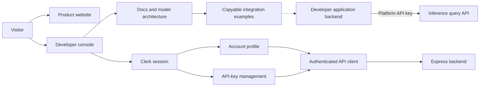

# Inference Frontend

The public website and developer console for Inference, built with **Next.js 16, React 19, TypeScript, and Clerk**. It introduces the multi-model workflow, guides developers through API integration, and connects account and API-key management to the Express backend.

A shared charcoal and indigo interface brings together responsive navigation, Geist typography, Lucide icons, model architecture views, and copyable Python/TypeScript examples.

See the [project overview](../README.md) for the complete setup flow and the [backend README](../backend/README.md) for database setup, the API contract, authentication, and request limits.

## Contents

- [Features](#features)
- [Run locally](#run-locally)
- [Application architecture](#application-architecture)
- [Routes and navigation](#routes-and-navigation)
- [Connected account and API keys](#connected-account-and-api-keys)
- [Integrating your application](#integrating-your-application)
- [Source layout](#source-layout)
- [Troubleshooting](#troubleshooting)
- [Checks](#checks)

## Features

| Area | Experience |
| --- | --- |
| Product website | Platform overview, query workflow, model ensemble, and FAQ |
| Developer console | Hash navigation, searchable sections, and mobile menu |
| Account | Clerk sign-in and synchronized backend profile with retry controls |
| API keys | Create, copy newly revealed secrets, list metadata, and revoke keys |
| Integration docs | Python/TypeScript tabs, clipboard actions, payload reference, and error guidance |
| Architecture | Shared model roster and conditional evaluation explanation |

## Run locally

Run from `frontend/`:

```powershell
bun install
Copy-Item .env.example .env
```

Set the values in `.env` before starting:

```env
NEXT_PUBLIC_CLERK_PUBLISHABLE_KEY=your_clerk_publishable_key
NEXT_PUBLIC_BACKEND_URL=http://localhost:5000
```

Copy the example environment file only on first setup; retain your existing values on later runs. After configuring `.env`, start the frontend:

```powershell
bun run dev
```

Use a publishable key from the same Clerk application as the backend. Open [the website](http://localhost:3000) or [the developer console](http://localhost:3000/console). Start the Express backend separately on port 5000 and ensure its CORS configuration allows your frontend origin.

The public pages and documentation render without Clerk configured. Sign-in and connected account/key management require the publishable key. Browser sign-in and direct API requests do not require a frontend Clerk secret. Optional Next.js server-side authentication and the `/api/me` proxy require `CLERK_SECRET_KEY`; the proxy origin uses `BACKEND_URL`, defaulting to `http://localhost:5000`. See [.env.example](.env.example).

### Environment reference

| Variable | Required for | Visibility |
| --- | --- | --- |
| `NEXT_PUBLIC_CLERK_PUBLISHABLE_KEY` | Sign-in and connected account/key pages | Public browser configuration |
| `NEXT_PUBLIC_BACKEND_URL` | Direct backend requests; defaults to localhost:5000 | Public browser configuration |
| `CLERK_SECRET_KEY` | Optional server authentication and `/api/me` proxy | Server only |
| `BACKEND_URL` | Optional profile proxy origin; defaults to localhost:5000 | Server only |

Platform API keys used by integrating applications belong in those applications' server environments. Inference provider keys belong in the Express backend.

For a production build:

```powershell
bun run build
bun run start
```

The build downloads Geist fonts through `next/font/google`, so Google Fonts must be reachable.

## Application architecture



The browser uses Clerk session tokens for account and key management. Inference requests originate in integrating applications' backends. The optional `/api/me` route supports a server-side profile proxy; the connected account page normally calls Express directly.

## Routes and navigation

| Route | Purpose |
| --- | --- |
| `/` | Product landing page, query workflow, models, evaluation, integration overview, and FAQ |
| `/console#overview` | Getting-started steps, platform capabilities, workflow, and model ensemble |
| `/console#keys` | Create, reveal/copy newly created keys, and revoke application API keys |
| `/console#models` | Three candidate models, orchestration, and evaluation architecture |
| `/console#history` | Availability notice for future usage and history reporting |
| `/console#account` | Signed-in identity and synchronized platform profile |
| `/console#docs` | Python/TypeScript examples, request/response reference, and error handling |
| `/api/me` | Optional authenticated server-side profile proxy |

The console uses hash navigation rather than separate pages for each section. Legacy `#playground` and `#workspace` links open integration docs; `#usage` opens history and `#settings` opens account. Mobile navigation, console search, keyboard search shortcut, FAQ expansion, documentation tabs, and clipboard actions are interactive.

## Product presentation

The public query workflow is:

**Query and context > parallel model calls > evaluation when multiple answers remain > final answer.**

The three candidate models are **GPT-OSS 20B**, **GPT-OSS 120B**, and **Nemotron 3 Ultra**. Candidate calls run in parallel, with one orchestration request active at a time. Multiple available candidates are evaluated; a single available candidate is returned directly. Model coordination is automatic. The evaluation section describes validation, assessment, and selection without naming its model. Product-facing workflow sections omit provider details and conversation identifiers. Technical response fields remain in the integration reference so the examples match the backend contract.

The landing page includes a split hero, architecture summary, five-stage workflow, model cards, evaluation layer, developer integration cards, console illustration, FAQ, and calls to open the console or documentation. The console shares the same visual foundations, including responsive cards, loading/error/empty states, and a getting-started panel.

Queries are submitted by integrating applications from their backends. The website has no query playground or browser query form. Usage/history reporting is not connected; no fabricated metrics, credentials, or generated answers are displayed. The console preview is an illustration rather than live activity.

## Connected account and API keys

The frontend obtains a Clerk session token and calls `/api/v1/users/me` directly. The backend synchronizes the local account; a missing email claim or other initialization error is shown with retry/refresh controls.

Key management uses `GET /api/v1/api-keys`, `POST /api/v1/api-keys`, and `DELETE /api/v1/api-keys/:id` with a Clerk session token. Accounts can store **three keys**. Stored metadata is refreshed after mutations, and a successful revoke is checked against the returned list.

New secrets stay in memory during the current page visit. Copy them before leaving; existing secrets cannot be retrieved after refresh because the backend stores hashes. The frontend never generates credentials or restores old browser-local demo keys.

Each account shares an allowance of **10 requests per minute and 100 per day** across its authenticated backend routes and API keys. HTTP 429 responses include a `Retry-After` header; the integration docs explain when to retry. Exact counting behavior is documented in the backend README.

## Integrating your application

The documentation has Python and TypeScript tabs. Both examples call `POST /api/v1/queries` using a platform key as `Authorization: Bearer <INFERENCE_API_KEY>`. Clerk sessions are used for account/key management, not query execution.

Set these variables in the integrating application's server environment:

```env
INFERENCE_BASE_URL=http://localhost:5000
INFERENCE_API_KEY=your_platform_api_key
```

`INFERENCE_BASE_URL` is the Express backend origin, without an API path. Keep the key server-side. The TypeScript example requires `zod` in the integrating application (`bun add zod` or `npm install zod`); the frontend itself does not need it to display the snippet.

The query request accepts these fields:

| Field | Description |
| --- | --- |
| `query` | Required non-empty question |
| `language` | Optional language context |
| `code` | Optional source code |
| `url` | Optional valid reference URL; its contents are not fetched |
| `responseType` | Optional `text` (default) or `json` |

Read `data.response` for the answer, `data.query` for the original input context, and `data.conversationId` for the request identifier. Optional `data.rawText` holds the answer before JSON parsing. The echoed query omits `responseType`.

Each request is independent: persisted history, follow-up context, and URL fetching are not implemented. Responses arrive as complete JSON rather than streamed tokens.

### Response modes and validation

The copyable examples default to `responseType: "text"`. Change that value to `"json"` and request your desired JSON structure in the query to receive parsed JSON. JSON mode does not guarantee a particular schema; validate the result against your application's requirements. JSON parse failures can return null.

Both examples reject `data.error` and missing/null answers, including the current backend's HTTP 200 envelope when all candidates fail. Text mode also requires a string answer. The TypeScript example validates the response envelope with Zod while allowing JSON values in `data.response` and preserving optional `data.rawText`.

Multiple available candidates are evaluated; a single available candidate bypasses evaluation. Queries can wait in the backend's process-local queue before execution, so adjust the examples' 120-second timeout for your deployment. HTTP 200 alone does not guarantee a usable answer.

## Source layout

| File or directory | Responsibility |
| --- | --- |
| `app/components/landing-page.tsx` | Public product page |
| `app/components/developer-console.tsx` | Console shell and section navigation |
| `app/components/query-architecture.tsx` | Shared model names, model cards, and evaluation architecture |
| `app/components/api-keys.tsx` | Connected key-management UI |
| `app/components/account.tsx` | Clerk account UI and profile synchronization |
| `app/components/integration-docs.tsx` | Integration documentation UI |
| `app/lib/api.ts` | Authenticated account/key requests and response validation |
| `app/lib/integration.ts` | Copyable snippets, example payloads, and workflow content |
| `app/lib/platform.ts` | Candidate model metadata and enforced key limit |
| `app/globals.css` | Base styles and existing component styling |
| `app/saas.css` | Shared SaaS presentation and responsive refinements |

Both stylesheets are imported by `app/layout.tsx` and should be included in a complete checkout.

## Troubleshooting

| Symptom | Check |
| --- | --- |
| Account or key requests cannot reach the API | Start the backend, confirm `NEXT_PUBLIC_BACKEND_URL`, and allow the frontend origin in backend CORS |
| A newly signed-in account cannot initialize | Use the same Clerk application in both services and include the user's email in the session `email` claim |
| HTTP 429 | Wait for the seconds reported in `Retry-After`; account, key-management, and query requests share the allowance |
| Missing `saas.css` import | Confirm `app/saas.css` exists in the checkout, then restart the development server if the error persists |
| Another development server is already running | Use its reported URL or stop that server before starting another process with the same Next.js output directory |
| Production build cannot download fonts | Allow the build environment to reach Google Fonts |

## Checks

```powershell
bun run lint
bunx tsc --noEmit
bun run test:unit
bun run build
bunx playwright install chromium
bun run test:e2e
```

The general browser suite runs with Clerk disabled on port 3100 using the isolated `.next-tests` directory. It covers desktop/mobile layouts, navigation, FAQ behavior, query-flow copy, model/evaluation content, documentation tabs and clipboard output, signed-out key access, account navigation, legacy links, and viewport containment. Screenshots are written to `test-results/`.

The separate Clerk UI check uses the configured publishable key and does not submit credentials:

```powershell
bun run test:auth
```

It starts a separate server on port 3111 by default. To use an existing frontend server:

```powershell
$env:AUTH_TEST_BASE_URL = 'http://localhost:3000'
bun run test:auth
```

Latest backend-alignment verification: production build, lint, TypeScript, 11 API unit tests, 7 integration-example tests, and 10 desktop/mobile browser tests passed. Live sign-in, authenticated key mutations, inference, and real rate-limit recovery were not exercised.

Run the copyable TypeScript example checks from `backend/` with `bun test integration/queryDocs.test.ts`. These use the backend's Zod dependency and mocked HTTP responses to verify text/JSON output, raw text, HTTP 200 error results, malformed responses, and environment validation.

See [DESIGN.md](DESIGN.md) for design decisions and [design-qa.md](design-qa.md) for screenshots, comparisons, and verification details.
